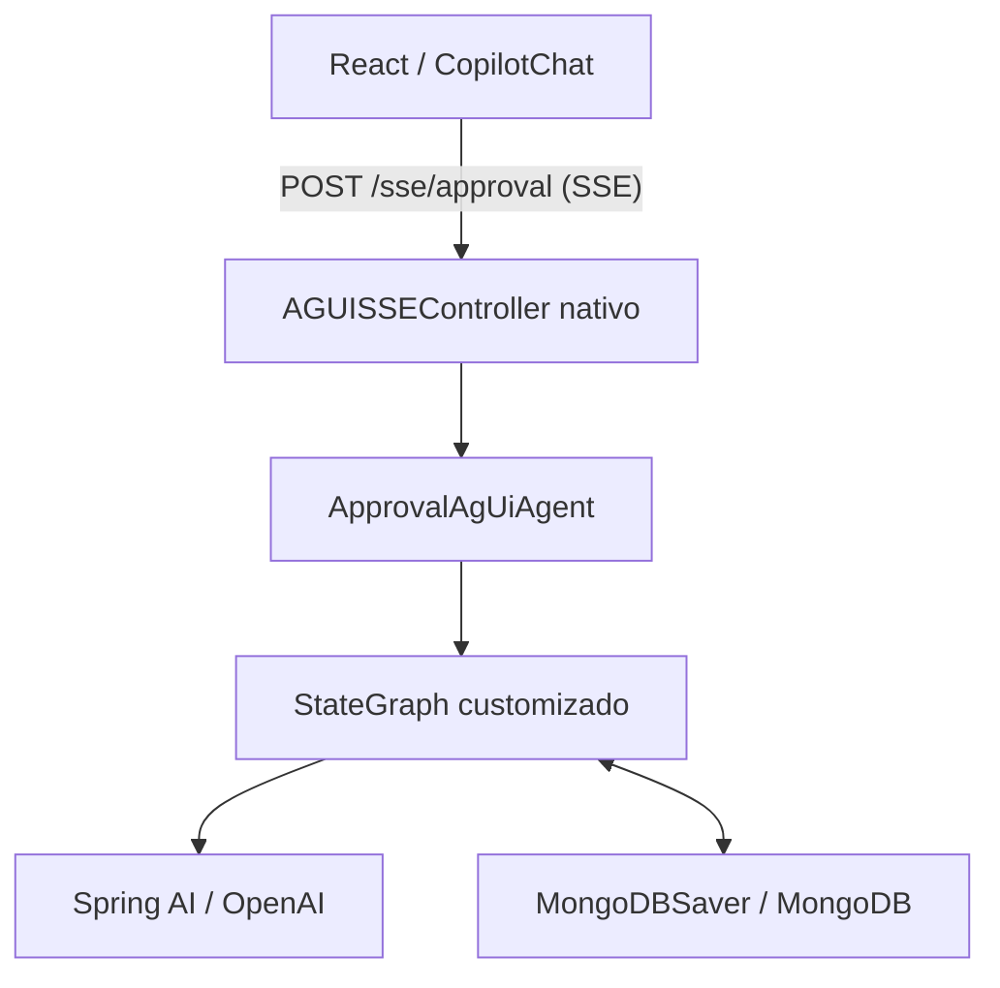
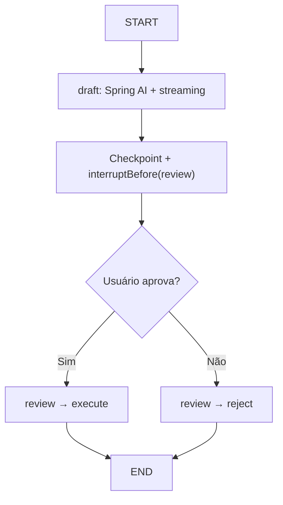

# LangGraph4j + AG-UI nativo + HITL + CopilotKit

Exemplo com **Java 25**, **Spring Boot 4 (Spring MVC)**, **Spring AI**, **LangGraph4j 1.9.7**, **MongoDB** e **React + CopilotKit v2**.

O `StateGraph` customizado continua responsável pela orquestração e pelo HITL. Para integrar o React, usamos **o módulo AG-UI nativo do LangGraph4j**: não há controller SSE escrito manualmente, nem um `Flow.Publisher` próprio para encaminhar cada token. Isso substitui o starter separado `com.ag-ui.community` da versão anterior do exemplo.

## Arquitetura



| Arquivo | Responsabilidade |
| --- | --- |
| `config/AgUiConfiguration.java` | Importa o controller nativo e registra o agente e serializer |
| `agui/ApprovalAgUiAgent.java` | Converte entrada AG-UI em `GraphInput`; HITL, eventos finais e restauração |
| `config/GraphConfiguration.java` | Cria `MongoDBSaver` e `CompiledGraph` singleton |
| `graph/ApprovalGraphFactory.java` | Define nós/arestas e `interruptBefore("review")` |
| `graph/ApprovalState.java` | Estado persistido: prompt, rascunho, decisão, resposta final |
| `graph/SpringAiDraftGenerator.java` | Gera rascunho com tokens do Spring AI |
| `frontend/src/App.tsx` | Configura CopilotKit, chat, `useInterrupt` e `threadId` |

### O backend AG-UI em duas peças

O `AgUiConfiguration` registra o endpoint **POST `/sse/approval`**:

```java
@Configuration
@Import(AGUISSEController.class)
public class AgUiConfiguration {
    @Bean
    AGUIAgentRegistry agentRegistry(ApprovalAgUiAgent agent) {
        return new AGUIAgentRegistry(agent);
    }

    @Bean
    Serializer agUiSerializer() {
        return new AGUIJacksonSerializer();
    }
}
```

O `ApprovalAgUiAgent` estende `AGUIAgentBase`. O método `newGraph()` devolve o grafo injetado. `graphInput()` decide se começa a tarefa ou retoma um checkpoint. `onNextEvents()` publica snapshots/resultado final; `onCompleteEvents()` converte uma interrupção real do LangGraph4j em `InterruptOutcome`.

O método `run()` foi sobrescrito **apenas** para requisições vazias de restauração no carregamento do React. Nas execuções normais, ele chama `super.run(input)`, reaproveitando o streaming implementado no próprio SDK.

## Grafo e Human-in-the-Loop



1. O usuário escreve uma solicitação no `CopilotChat`, que envia `threadId`, `runId` e mensagem ao endpoint AG-UI.
2. `ApprovalAgUiAgent.graphInput()` constrói `GraphInput.args(...)`. A `threadId` é o identificador do checkpoint.
3. O nó `draft` chama o Spring AI. Cada token é enviado pelo `customDispatcher()` do LangGraph4j como `TextMessageContentEvent`. O `AGUIAgentBase` cuida de encaminhá-los por SSE.
4. O texto completo é armazenado em `draft`. **Antes de executar `review`**, o LangGraph4j grava o checkpoint com `MongoDBSaver` e interrompe a execução.
5. O adaptador emite `RUN_FINISHED`, com `outcome.type = "interrupt"`, id `<threadId>:review` e payload exigido `{ approved: boolean }`.
6. O hook `useInterrupt` apresenta os botões **Aprovar e continuar** e **Rejeitar**. O CopilotKit transmite a resposta no campo AG-UI `resume`.
7. O adaptador verifica que a aprovação pertence ao checkpoint pendente, valida o booleano e chama `GraphInput.resume(Map.of("approved", ...))`.
8. O LangGraph4j recarrega o estado, passa por `review` e segue deterministicamente para `execute` ou `reject`. **O nó `draft` não roda de novo.**

O nó `execute` é **simulado**, somente gera uma resposta final; ele não dispara pagamentos, vendas nem operações UCP/MCP.

### Atualização da página (F5)

A `threadId` é guardada no `localStorage`. Quando a página monta, o cliente consulta o endpoint com `messages: []`. O `ApprovalAgUiAgent.run()` detecta essa consulta e responde com:

- `STATE_SNAPSHOT`: estado do grafo no checkpoint;
- `MESSAGES_SNAPSHOT`: prompt, rascunho e resposta final;
- `RUN_FINISHED` com `InterruptOutcome` se `review` estiver pendente; caso contrário, `SuccessOutcome`.

Esse caminho **não avança o grafo e não chama a LLM**. Uma aprovação pendente pode reaparecer depois de atualizar a página ou reiniciar o backend, se o MongoDB mantiver o checkpoint.

## Como executar

### A. Backend + MongoDB no Docker

Requisitos: Docker e Compose, Node.js **20.19+**, chave válida de OpenAI.

1. Copie `.env.example` para `.env`, preencha `OPENAI_API_KEY`.
2. Na raiz:

   ```bash
   docker compose up --build
   ```

3. Em outro terminal:

   ```bash
   cd frontend
   npm ci
   npm run dev
   ```

4. Abra **http://localhost:5173**.

O Vite encaminha as chamadas `/sse` para `http://localhost:8080`. O volume `mongo_data` preserva os checkpoints após reiniciar os contêineres.

### B. Backend local

Requisitos: JDK 25, Maven 3.9+, MongoDB na porta 27017 e `OPENAI_API_KEY` definida.

```bash
docker compose up -d mongo
mvn spring-boot:run
```

Em outro terminal, execute `cd frontend && npm ci && npm run dev`.

### Testar

```bash
mvn test
cd frontend
npm ci
npm run build
```

Os testes Java usam `MemorySaver` e uma implementação falsa de `DraftGenerator`: não exigem OpenAI nem MongoDB. Testam tokens, interrupção, rejeição, aprovação e restauração. Não substituem um teste de ponta a ponta com infraestrutura real.

## Endpoint AG-UI via curl

**Iniciar:** `threadId` e `runId` são UUIDs; use um `runId` novo para cada requisição.

```bash
curl -N -X POST http://localhost:8080/sse/approval \
  -H 'Content-Type: application/json' \
  -d '{"threadId":"18db0090-1554-48ee-a6ba-70b913e200a9","runId":"f2120d7f-b76e-4891-8f8d-73f28467c768","messages":[{"id":"u1","role":"user","content":"Crie um plano de testes"}],"tools":[],"context":[],"state":{}}'
```

**Retomar depois do evento de interrupção:**

```bash
curl -N -X POST http://localhost:8080/sse/approval \
  -H 'Content-Type: application/json' \
  -d '{"threadId":"18db0090-1554-48ee-a6ba-70b913e200a9","runId":"07d4b65e-631c-4004-afb8-a2ec7706cf7b","messages":[],"tools":[],"context":[],"state":{},"resume":[{"interruptId":"18db0090-1554-48ee-a6ba-70b913e200a9:review","status":"resolved","payload":{"approved":true}}]}'
```

Para rejeitar, altere `approved` para `false`. Para consultar sem continuar, envie `messages: []` e `resume: []` com a mesma `threadId`.

## Compatibilidade AG-UI / CopilotKit

O SDK Java nativo do LangGraph4j 1.9.7 utiliza a família anterior de mensagens AG-UI. O CopilotKit v2 utiliza `@ag-ui/client` mais recente. Por isso, o frontend inclui `@ag-ui/spring-ai@0.0.4` **somente como adaptador do transporte JavaScript**: `SpringAiAgent` estende o cliente HTTP AG-UI e limita a versão do protocolo encaminhado. Isso não substitui nem adiciona outro Spring AI no backend.

No React, `CopilotKitProvider` usa `agents__unsafe_dev_only` para se conectar ao Java diretamente, sem um runtime Node.js. Esse modo é para desenvolvimento e protótipo; avalie um Runtime CopilotKit ou uma integração segura equivalente para produção.

## Restrições de produção

- O exemplo **não implementa autenticação/autorização**. Associe `threadId` ao usuário autenticado e verifique ownership em toda leitura e retomada.
- Duas requisições simultâneas para a mesma thread podem concorrer. Adicione controle distribuído (ou versionamento com CAS) antes de escalar.
- Uma desconexão SSE pode perder tokens; checkpoints guardam **estado e posição do grafo**, não o log de deltas AG-UI.
- `ObjectStreamStateSerializer` produz um formato binário Java; planeje migrações de classes e compatibilidade de checkpoints.
- A ação `execute` é uma simulação; chamadas externas reais (MCP/UCP, checkout) requerem idempotência e regras de autorização.
- Cada `threadId` representa uma tarefa única. Não é um chatbot multi-turno com memória conversacional completa.
- A compilação e os testes com fakes foram realizados, **não** um teste HTTP integrado com conta OpenAI, MongoDB e navegador real.

## Referências

- [LangGraph4j — módulo AG-UI](https://github.com/langgraph4j/langgraph4j)
- [LangGraph4j — MongoDBSaver](https://github.com/langgraph4j/langgraph4j/tree/main/langgraph4j-mongodb-saver)
- [CopilotKit — documentação](https://docs.copilotkit.ai/)
- [Spring AI — documentação](https://docs.spring.io/spring-ai/reference/)
